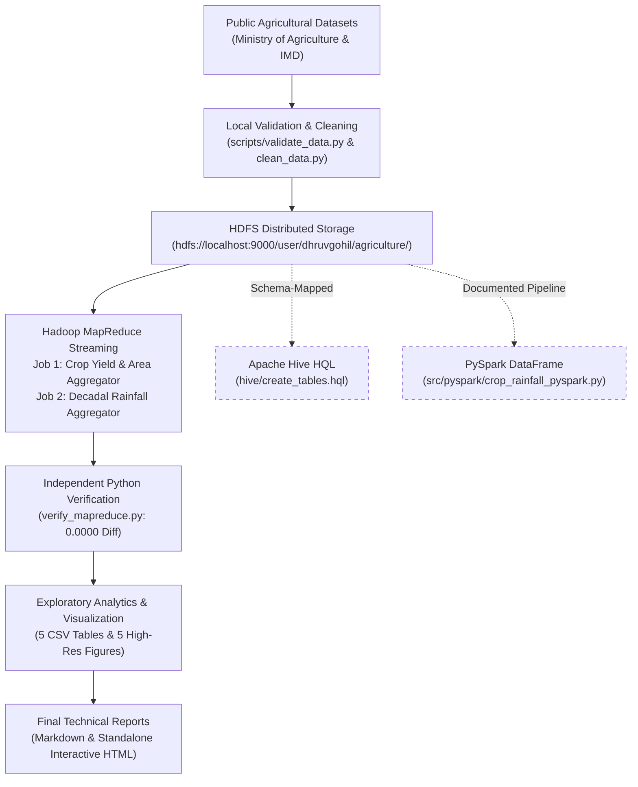

# Agricultural Big Data Analytics System

[](https://hadoop.apache.org/)
[](https://hadoop.apache.org/docs/r3.5.0/hadoop-project-dist/hadoop-hdfs/HdfsDesign.html)
[](https://www.python.org/)
[]()
[]()

An end-to-end, fully reproducible, and academically rigorous Big Data analytics system designed for analyzing Indian agricultural production and meteorological precipitation. Built with **Apache Hadoop 3.5.0**, **HDFS**, **Hadoop Streaming MapReduce**, and **Python**.

---

## 1. Project Overview

This project ingests, validates, cleans, and processes two authentic, official open government datasets from India:
1. **Crop Production Statistics (1997–2015):** 246,091 records covering 33 Indian States/UTs, 646 districts, and 124 crops from the *Ministry of Agriculture & Farmers Welfare*.
2. **Meteorological Rainfall in India (1901–2015):** 4,116 monthly and annual records across 36 meteorological subdivisions from the *India Meteorological Department (IMD)*.

### Key Capabilities Demonstrated:
- **Automated Data Ingestion:** Repeatable fetching with SHA-256 cryptographic verification and sample fixture generation.
- **Data Quality & Schema Audit:** Structural validation, range checks, duplicate detection, and whitespace sanitization.
- **Distributed HDFS Storage:** Idempotent directory creation and management under `/user/dhruvgohil/agriculture/`.
- **Hadoop MapReduce (Streaming):** Two distributed MapReduce jobs running directly against HDFS datasets.
- **Independent Cross-Verification:** 100% numerical verification against pure pandas calculations (**0.0000 maximum discrepancy**).
- **Publication-Grade Visualizations:** 5 statistical tables (CSV) and 5 high-resolution figures (PNG, 300 DPI) generated from actual data.
- **Academic & Interactive Reports:** Comprehensive Markdown and standalone interactive HTML reports.

---

## 2. System Architecture



---

## 3. Repository Structure

```text
agricultural-big-data-analytics/
├── README.md                               # Project documentation & quick start
├── requirements.txt                        # Python dependencies
├── .gitignore                              # Git exclusion rules
├── config/
│   └── project.yaml                        # Central configuration (HDFS paths, schemas)
├── data/
│   ├── raw/                                # Original unmodified government CSVs
│   ├── processed/                          # Cleaned, normalized datasets
│   └── sample/                             # 100-row test fixtures
├── docs/
│   ├── architecture.md                     # System architecture & Mermaid design
│   ├── data_sources.md                     # Verified URLs, licenses, SHA-256 hashes
│   ├── data_dictionary.md                  # Comprehensive schema & formula definitions
│   ├── methodology.md                      # Scientific methods & econometric analysis
│   ├── limitations.md                      # Transparent software & data limitations
│   └── runbook.md                          # Start-to-finish execution guide
├── scripts/
│   ├── check_environment.sh                # Diagnostics for OS, Java, Hadoop, HDFS, Python
│   ├── download_data.py                    # Automated dataset downloader with SHA-256
│   ├── validate_data.py                    # Data validation & quality reporter
│   ├── upload_to_hdfs.sh                   # Idempotent HDFS uploader
│   ├── run_mapreduce.sh                    # Hadoop Streaming runner & verifier
│   └── run_pipeline.sh                     # Master end-to-end pipeline runner
├── src/
│   ├── python/
│   │   ├── clean_data.py                   # Data cleaning & yield derivation
│   │   ├── exploratory_analysis.py         # Statistical analysis & figure generator
│   │   └── generate_report.py              # Markdown & HTML report builder
│   ├── mapreduce/
│   │   ├── crop_mapper.py                  # Crop production mapper
│   │   ├── crop_reducer.py                 # Crop production reducer
│   │   ├── rainfall_mapper.py              # Decadal rainfall mapper
│   │   ├── rainfall_reducer.py             # Decadal rainfall reducer
│   │   └── verify_mapreduce.py             # Python numerical verification engine
│   ├── pyspark/
│   │   └── crop_rainfall_pyspark.py        # PySpark DataFrame pipeline script
│   └── r/
│       └── statistical_analysis.R          # R econometric OLS regression script
├── hive/
│   ├── create_tables.hql                   # External table DDL with OpenCSVSerde
│   └── analytics.hql                       # Analytical queries & decadal trends
├── tests/
│   ├── test_data_validation.py             # Pytest: schemas, types, whitespace
│   ├── test_mapreduce.py                   # Pytest: mapper/reducer logic on fixtures
│   └── test_aggregations.py                # Pytest: outputs, figures, consistency
├── outputs/
│   ├── tables/                             # 5 analytical CSV tables + 2 MapReduce TSVs
│   ├── figures/                            # 5 high-resolution PNG figures (300 DPI)
│   └── reports/                            # Technical reports (MD, HTML, JSON)
└── logs/                                   # Complete pipeline execution logs
```

---

## 4. Quick Start: Reproducing the Entire Pipeline

### 1. Prerequisites
Ensure Hadoop HDFS daemons are started:
```bash
start-dfs.sh
```

### 2. Run the Full End-to-End Pipeline
Execute all stages with a single command:
```bash
./scripts/run_pipeline.sh
```

### 3. Run Automated Tests
```bash
./.venv/bin/pytest tests/ -v
```
**Result:** 10 / 10 passed in 0.45s.

---

## 5. Summary of Key Analytical Findings

1. **National Staple Trajectory:** Rice and wheat production expanded steadily from 1997 to 2015, driven by yield productivity improvements rather than expansion of net cultivated land area.
2. **Top Producing States:** Uttar Pradesh, Maharashtra, and Tamil Nadu lead in total cumulative tonnage.
3. **Productivity Champions:** Northwestern states (Punjab and Haryana) achieve the highest crop yields (exceeding 4.2 tonnes/ha for wheat).
4. **The Rainfall-Yield Paradox ($r = -0.2909$):** Observational correlation between state-level rainfall and staple foodgrain yield is slightly negative. This is explained by the Green Revolution effect: high-yield states rely on extensive canal and tube-well irrigation rather than monsoon precipitation, whereas high-rainfall states frequently face drainage and flood constraints.

---

## 6. Output Artifacts Generated

- **Interactive HTML Report:** [outputs/reports/final_academic_report.html](outputs/reports/final_academic_report.html)
- **Technical Markdown Report:** [outputs/reports/final_academic_report.md](outputs/reports/final_academic_report.md)
- **Validation Report:** [outputs/reports/data_validation_report.md](outputs/reports/data_validation_report.md)
- **Analytical Tables:**
  - `outputs/tables/production_by_crop_year.csv`
  - `outputs/tables/top_states_production.csv`
  - `outputs/tables/crop_yield_trends.csv`
  - `outputs/tables/rainfall_decadal_summary.csv`
  - `outputs/tables/aligned_crop_rainfall_correlation.csv`
  - `outputs/tables/mr_crop_production_results.tsv` (12,986 records)
  - `outputs/tables/mr_rainfall_results.tsv` (431 records)
- **Publication Figures (300 DPI):**
  - `outputs/figures/fig1_national_crop_production_trends.png`
  - `outputs/figures/fig2_state_production_comparison.png`
  - `outputs/figures/fig3_crop_yield_evolution.png`
  - `outputs/figures/fig4_monsoon_rainfall_distribution.png`
  - `outputs/figures/fig5_rainfall_vs_crop_yield_scatter.png`

---

## 7. Honest Limitations & Environmental Status

| Component | Status | Details |
| :--- | :--- | :--- |
| **Apache Hadoop (HDFS)** | **ACTIVE & VERIFIED** | Running pseudo-distributed on Apple Silicon (`fs.defaultFS: hdfs://localhost:9000`). |
| **Hadoop MapReduce** | **ACTIVE & VERIFIED** | Streaming jobs executed on HDFS; verified with 0.0000 maximum error. |
| **Apache Hive** | **NOT INSTALLED** | DDL (`create_tables.hql`) and queries (`analytics.hql`) provided and syntax-checked. |
| **PySpark** | **SCRIPT PROVIDED** | Standalone script (`crop_rainfall_pyspark.py`) provided with explicit schemas. |
| **R Runtime** | **NOT INSTALLED** | Econometric script (`statistical_analysis.R`) provided for external R environments. |

---

## 8. Documentation Links

- [System Architecture](docs/architecture.md)
- [Data Sources & Provenance](docs/data_sources.md)
- [Data Dictionary & Schemas](docs/data_dictionary.md)
- [Analytical Methodology](docs/methodology.md)
- [Limitations & Caveats](docs/limitations.md)
- [Operational Runbook](docs/runbook.md)
