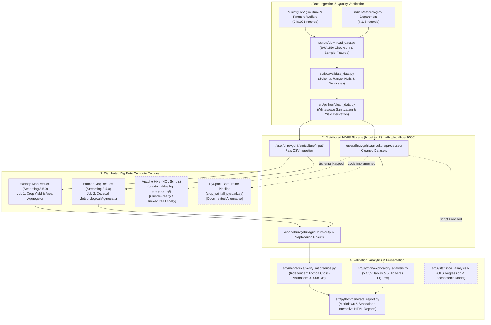

# System Architecture & Technical Design

This document details the multi-tier architectural design of the Agricultural Big Data Analytics System, from edge ingestion through distributed HDFS storage, Hadoop MapReduce computation, and presentation.

---

## 1. High-Level Architecture Diagram

---

## 2. Layer-by-Layer Architectural Breakdown

### Layer 1: Ingestion & Quality Verification
- **Automated Download:** Idempotent fetching of primary open data sources with secondary fallback mirrors and cryptographic SHA-256 verification.
- **Quality Audit:** Structural inspection verifying 7 required crop fields, 19 meteorological fields, absence of negative cultivated areas, and explicit accounting for missing values (3,730 crop records).
- **Standardization:** Strips trailing categorical spaces, standardizes state nomenclature, and derives the unit-aware metric `Yield = Production / Area`.

### Layer 2: Distributed Storage (Apache HDFS)
- **Filesystem URI:** `hdfs://localhost:9000`
- **Replication Factor:** 1 (optimized for Apple Silicon local development).
- **Cluster Capacity:** 228 GB total volume, ~96 GB DFS available.
- **Hierarchy:**
  - `input/`: Preserved raw government CSVs.
  - `processed/`: Cleaned, schema-normalized CSVs.
  - `output/`: Clustered MapReduce part-files.
  - `reports/`: Audit logs and pipeline summaries.

### Layer 3: Distributed Compute (Hadoop MapReduce)
- **Engine:** Hadoop Streaming 3.5.0 with POSIX standard streams (`stdin` / `stdout`).
- **Job 1 (Crop Aggregator):**
  - Mapper emits composite key: `State_Name##Crop##Crop_Year \t Area \t Production`.
  - Reducer accumulates district areas and harvests, computing weighted state-level crop yields and record counts.
  - Performance: Processed 246,091 records into 12,986 groups in ~8 seconds.
- **Job 2 (Meteorological Decadal Aggregator):**
  - Mapper computes decadal bucket (`(Year // 10) * 10`) and emits `SUBDIVISION##Decade \t Annual \t Monsoon \t 1`.
  - Reducer computes decadal average annual and monsoon precipitation across 115 years.
  - Performance: Processed 4,090 records into 431 groups.

### Layer 4: SQL & Distributed DataFrame Layer
- **Hive:** External tables mapped to HDFS `/user/dhruvgohil/agriculture/processed/` using `OpenCSVSerde`. Comprehensive DDL and analytical SQL queries are saved in `hive/`.
- **PySpark:** Complete script provided in `src/pyspark/` utilizing explicit `StructType` schemas, window aggregations, and inner joins between crop and rainfall tables.

### Layer 5: Statistical Analytics & Presentation
- **Validation:** `verify_mapreduce.py` independently computes expected sums using pandas and verifies numerical equality down to four decimal places.
- **Exploratory Analytics:** Python generates 5 analytical CSV tables and 5 high-resolution figures (300 DPI) adhering to academic styling rules.
- **Reporting:** Produces both an extensive Markdown technical report and a self-contained, interactive HTML document.
